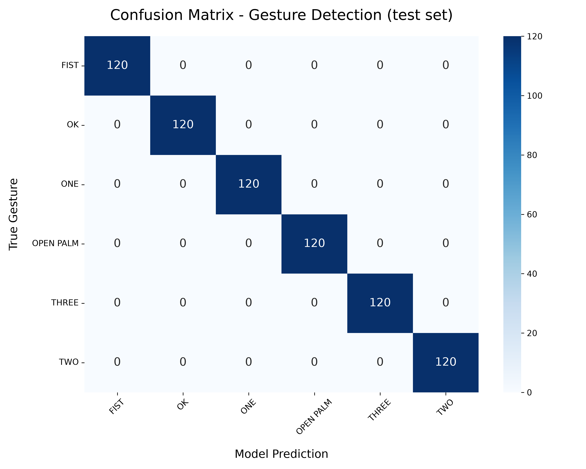
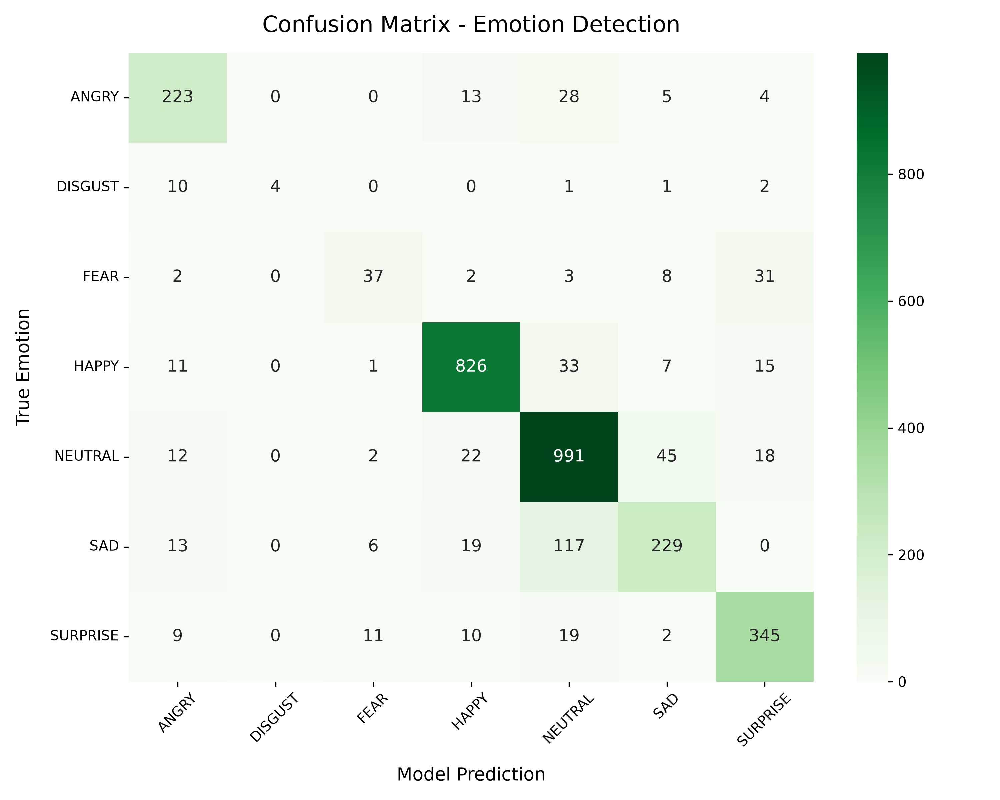
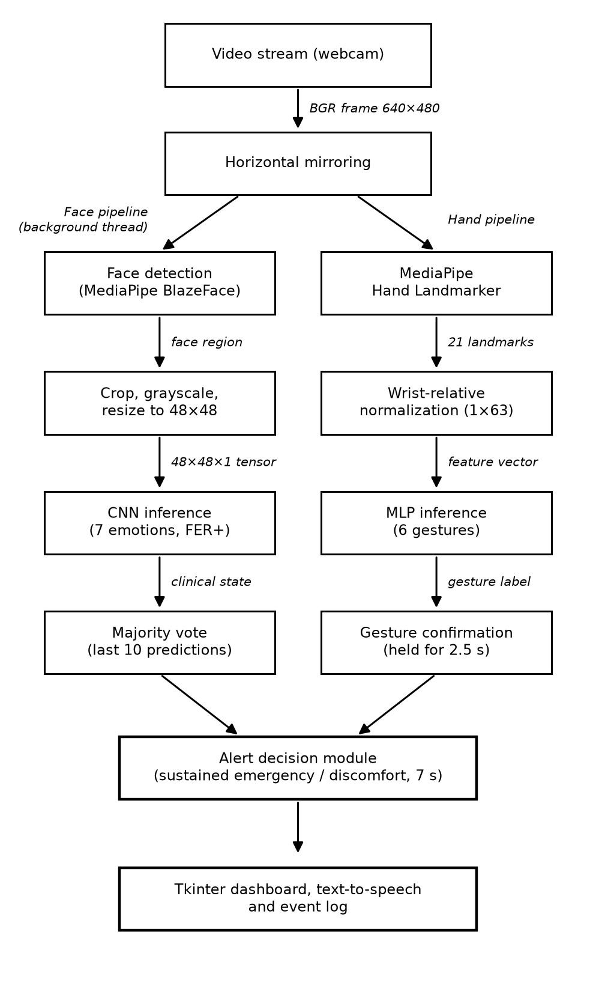

# Assistive Medical Monitoring System

[](https://github.com/Cosmin-TeodorCretu37/Bachelor-sThesis/actions/workflows/ci.yml)

A real-time, webcam-only assistant for patients who cannot speak (intubated or with severe motor impairments). It recognizes **hand gestures as commands** and monitors **facial expressions for signs of discomfort**, then raises visual and spoken alerts for the medical staff. Everything runs locally on a laptop CPU, with no GPU and no cloud.

Bachelor's thesis project, "Gheorghe Asachi" Technical University of Iași, Faculty of Automatic Control and Computer Engineering, 2026.

<!-- Add a short demo here: portfolio/images/demo.gif (record the app with ScreenToGif or ShareX) -->

## What it does

- **Gesture commands.** Six static hand gestures map to medical requests: emergency, water, pain, call a nurse, adjust the bed, cancel. A gesture becomes a command once it is held for 2.5 seconds, and the command is spoken aloud.
- **Passive discomfort monitoring.** Facial expressions are classified into 7 emotions and grouped into clinical states (stable / comfort / discomfort).
- **Sustained alerts.** A closed fist held for 7 seconds, or discomfort lasting 7 seconds, triggers a flashing banner and a repeated voice alert, which stays active until the patient cancels it with an open palm.
- **Clinical dashboard.** Per-module on/off switches, adjustable thresholds that persist between sessions, a command history, and a daily CSV event log.

## Results

| | Metric | Value |
|---|---|---|
| Gestures (MLP) | Accuracy on a held-out test set (720 samples) | **100%** |
| Emotions (CNN) | Accuracy on the FER+ test set (3,137 images, 7 classes) | **84.6%** |
| Discomfort detection | Recall / false-alarm rate on FER+ test faces | **82.1% / 8.8%** |
| Performance | Frame rate · main-loop time per frame | **~30 FPS · ~19 ms** |
| Footprint | RAM (working set) · CPU load (AMD Ryzen 7 7730U) | **~0.5 GB · ~7.5%** |

The gesture dataset was recorded by a single person, so the 100% figure reflects consistent data from one user; it does not prove generalization to other people.

<p align="center">
  
  
</p>

## Architecture

<p align="center"></p>

Each webcam frame is mirrored and sent down two pipelines:

- **Hand pipeline (main loop, every frame).** MediaPipe Hand Landmarker returns 21 3D landmarks. They are normalized relative to the wrist (63 numbers, position- and scale-invariant) and classified by a small MLP (63 → 128 → 64 → 32 → 6).
- **Face pipeline (background thread, every 3rd frame).** MediaPipe BlazeFace finds the face. The crop is calibrated to match the FER2013 framing, converted to a 48×48 grayscale image and classified by a compact CNN into 7 emotions. A majority vote over the last 10 predictions removes flicker.

## Engineering decisions

| Problem | Decision | Effect |
|---|---|---|
| Raw-pixel gesture models are slow and sensitive to background and lighting | Classify MediaPipe landmarks instead of pixels | A tiny MLP, sub-millisecond inference |
| The Haar Cascade face detector missed faces at an angle | Switched to MediaPipe BlazeFace, with a crop calibrated on FER2013 framing | Face found in 40/40 webcam frames (Haar: 0/40), about 4× faster |
| FER2013 labels are noisy (≈65% accuracy ceiling for small CNNs) | Retrained the same CNN on Microsoft's FER+ relabeling (majority of 10 annotators) | 64.7% → **84.6%** test accuracy, with no architecture change |
| Running both models in sequence dropped the frame rate to ~20 FPS | Face analysis moved to a background worker thread | Stable ~30 FPS (camera-limited) |
| Missing pain is worse than an extra alert | Discomfort is declared when the 4 negative emotions together reach 30% probability | Discomfort recall 71% → 82% |
| Evaluation leakage in the original pipeline | Train/test split before mirroring augmentation; the emotion model is selected on the official validation split, and the test set is used once | Honest, reproducible metrics |

## Tech stack

Python 3.12 · TensorFlow / Keras · MediaPipe (Hand Landmarker, BlazeFace) · OpenCV · NumPy · Tkinter · pyttsx3 · pytest · Ruff · GitHub Actions

## Run it

**Windows executable:** download the latest build from the repository's **Releases** page, unzip it, and run `AssistiveMedicalSystem.exe`.

**From source** (Windows, Python 3.12, a webcam):

```bash
python -m venv .venv
.venv\Scripts\activate
pip install -r requirements.txt
python app.py
```

## Retrain the models

```bash
pip install -r requirements-training.txt

python training/collect_gesture_data.py      # record gestures with on-screen validation
python training/train_gesture_model.py

python training/prepare_ferplus.py           # needs fer2013.csv (Kaggle) and fer2013new.csv (Microsoft FERPlus)
python training/train_emotion_model.py       # about an hour on CPU

python training/evaluation/evaluate_gesture_model.py
python training/evaluation/evaluate_emotion_model.py
```

## Tests

```bash
pip install -r requirements-dev.txt
pytest
ruff check .
```

The test suite covers the gesture-confirmation and alert timing logic, the background worker, landmark normalization, the discomfort decision rule, the settings and event-log persistence, and the consistency between the models' label files and the application.

## Project structure

```
app.py                  main window and video loop
src/
  detectors.py          MediaPipe hand and face detectors, landmark normalization
  gesture_classifier.py MLP inference and gesture-to-command mapping
  emotion_classifier.py CNN inference, discomfort rule, emotion-to-clinical-state mapping
  background_worker.py  worker thread for the face pipeline
  monitoring.py         gesture confirmation and sustained-alert timers
  speech.py             non-blocking text-to-speech
  settings.py           persisted patient settings
  event_log.py          daily CSV event log
  config.py             paths, thresholds, colors
models/                 trained models, label maps, MediaPipe task files
training/               data collection, FER+ preparation, training and evaluation scripts
tests/                  pytest suite
portfolio/              README images and the PyInstaller build script (build_exe.py)
```

## Limitations

- Static gestures only; dynamic gestures (such as waving) would need a sequence model.
- The gesture data comes from a single user.
- Disgust and fear remain hard to recognize (22% and 45% recall), because there are very few examples of them even in FER+.
- Webcam-based detection degrades in very low light; night monitoring would need an infrared camera.

## Data and credits

- FER2013: Goodfellow et al., *Challenges in Representation Learning*, ICONIP 2013.
- FER+ labels: Barsoum et al., *Training Deep Networks for Facial Expression Recognition with Crowd-Sourced Label Distribution*, ICMI 2016.
- MediaPipe Hand Landmarker and BlazeFace by Google.
